### 静かに創り、世界を変える。

*Build quietly. Change what matters.*

**Founder & CTO @ ALZA** · **Full-Stack Engineer** · **Systems Architecture Enthusiast**

創設者・最高技術責任者 ｜ フルスタックエンジニア ｜ ものづくりが好き。

 

`設計` · `開発` · `セキュリティ` · `創造`

---

こんにちは、azinamouto です。

I'm a **full-stack developer and Founder & CTO of ALZA**, a technology venture focused on developing practical digital solutions.

I've been coding for around **six years**, exploring different technologies, architectures, and ways to turn ideas into functional software.

My work spans frontend interfaces, backend services, databases, infrastructure, security engineering, and developer tooling.

I'm particularly interested in building systems that solve real-world problems, especially in **government technology, information management, automation, and applied AI**.

I enjoy understanding how systems work beneath the surface, not just making interfaces look good.

Outside engineering? I love anime, obviously. :>

> **完璧より前進。**
>
> Progress over perfection.

### `02 / 技術構成 — my technology stack`

**技術と創造 — TECHNOLOGY & CREATION**

 

  

  

技術は道具。創造こそが目的。

Technology is the tool. Creation is the purpose.

### `03 / 開発中の作品 — some of my nonsense projects`

**作って、壊して、また作る。**

*Build. Break. Understand. Rebuild.*

| Project | Engineering focus |
| :--- | :--- |
| [Shinigami](https://github.com/azinamouto/shinigami) | Security scanning, dependency vulnerability analysis, and SARIF reporting |
| [Kuro](https://github.com/azinamouto/kuro) | Go-based CLI development and developer tooling |
| [ALZA Devkit](https://github.com/azinamouto/alza-devkit) | Mock-data generation, database schemas, and development utilities |
| [ALZA Finstation](https://github.com/azinamouto/alza-Finstation) | Financial tracking and operational management |
| [ALZA AI Lab](https://github.com/azinamouto/alza-ai-lab) | Applied AI experiments and engineering prototypes |
| [TAGAD Foundation](https://github.com/azinamouto/TAGAD-FOUNDATION) | Information systems and application development |

進行中 — Projects may be experimental, under development, or privately maintained.

### `04 / 開発記録 — contribution activity`

**日々の積み重ね。**

*Small steps, every day.*

 

  

  

継続は力なり。 — Consistency is strength.

### `05 / これから — know more?`

I'm interested in the intersection of **software engineering, systems architecture, security, and real-world digital transformation**.

Through ALZA and my personal projects, I'm continuously exploring how technology can make workflows simpler, information more accessible, and software systems more reliable.

**まだ始まったばかり。**

*This is only the beginning.*

### まだ途中。

*Still a work in progress.*

**静かに、着実に。**

*Quietly, steadily.*

 

`less noise. more commits.`

  

ありがとう、またね。 — Thanks for stopping by. See you around.

  

