**RAARARARARAAAAAH!!!** · **IT'S ME AKEII** ·
**Founder & CTO @ ALZA** · **Full-Stack Engineer**

創設者・最高技術責任者 ｜ フルスタックエンジニア ｜ ものづくりが好き。

 

`設計` · `開発` · `セキュリティ` · `創造`

 

  

 

こんにちは、azinamouto です。

I'm a **full-stack developer and Founder & CTO of ALZA**, a technology venture focused on developing practical digital solutions.

I've been coding for around **six years**, exploring different technologies, architectures, and ways to turn ideas into functional software.

My work spans frontend interfaces, backend services, databases, infrastructure, security engineering, and developer tooling.

I'm particularly interested in building systems that solve real-world problems, especially in **government technology, information management, automation, and applied AI**.

I enjoy understanding how systems work beneath the surface, not just making interfaces look good.

Outside engineering? I love anime, obviously. :>

 

 

**技術と創造 — TECHNOLOGY & CREATION**

 

<table>
  <tr>
    <td align="center" width="170"><b>⌨️ LANGUAGES</b> 言語</td>
    <td align="center"></td>
  </tr>
  <tr>
    <td align="center"><b>🎨 FRONTEND</b> フロントエンド</td>
    <td align="center"></td>
  </tr>
  <tr>
    <td align="center"><b>⚙️ BACKEND</b> バックエンド</td>
    <td align="center"></td>
  </tr>
  <tr>
    <td align="center"><b>📱 MOBILE</b> モバイル</td>
    <td align="center"></td>
  </tr>
  <tr>
    <td align="center"><b>🚀 DEVOPS & TOOLS</b> 開発基盤</td>
    <td align="center"></td>
  </tr>
</table>

 

<b>🛡️ SECURITY ・ セキュリティ</b>

 

 

  

**作って、壊して、また作る。**

*Build. Break. Understand. Rebuild.*

 

<table>
  <tr>
    <td width="50%" valign="top">
      <h3> <a href="https://github.com/azinamouto/shinigami">Shinigami</a></h3>
      Security scanning, dependency vulnerability analysis, and SARIF reporting
        
      
    </td>
    <td width="50%" valign="top">
      <h3> <a href="https://github.com/azinamouto/kuro">Kuro</a></h3>
      Go-based CLI development and developer tooling
        
      
    </td>
  </tr>
  <tr>
    <td width="50%" valign="top">
      <h3> <a href="https://github.com/azinamouto/alza-devkit">ALZA Devkit</a></h3>
      Mock-data generation, database schemas, and development utilities
        
      
    </td>
    <td width="50%" valign="top">
      <h3> <a href="https://github.com/azinamouto/alza-Finstation">ALZA Finstation</a></h3>
      Financial tracking and operational management
        
      
    </td>
  </tr>
  <tr>
    <td width="50%" valign="top">
      <h3> <a href="https://github.com/azinamouto/alza-ai-lab">ALZA AI Lab</a></h3>
      Applied AI experiments and engineering prototypes
        
      
    </td>
    <td width="50%" valign="top">
      <h3> <a href="https://github.com/azinamouto/TAGAD-FOUNDATION">TAGAD Foundation</a></h3>
      Information systems and application development
        
      
    </td>
  </tr>
</table>

進行中 — Projects may be experimental, under development, or privately maintained.

 

 

 

### まだ途中 **静かに、着実に。**

ありがとう、またね。 — Thanks for stopping by. RARARARARARAAAAAAH!!!!!

 

