<div align="center">



### 静かに創り、世界を変える。
*Build quietly. Change what matters.*

**Founder & CTO @ ALZA** · **Full-Stack Engineer** · **Systems Architect in progress**

<sub>創設者・最高技術責任者 ｜ フルスタック開発者 ｜ ものづくりが好き。</sub>

</div>

---

### `01  — who am i`

```text
$ cat identity.txt
alias       : azinamouto
role        : Founder & CTO · ALZA
focus       : Full-stack engineering / GovTech / developer tooling
interests   : Systems design / security / automation / applied AI
```

I'm a full-stack developer and **Founder & CTO of ALZA**, working on practical software for real-world problems. I move between frontend interfaces, backend services, databases, infrastructure, and the less glamorous engineering work that makes systems reliable.

My work spans **government-oriented information systems, developer utilities, security tooling, and experimental applications**. I care about thoughtful architecture, usable interfaces, and software that can grow beyond its first demo.


### `02 / 技術構成 — stack`

<div align="center">


</div>

### `03 / 開発中の作品 — selected builds`

| Project | Engineering focus |
| :--- | :--- |
| [Shinigami](https://github.com/azinamouto/shinigami) | Security scanning, dependency analysis, and SARIF reporting |
| [Kuro](https://github.com/azinamouto/kuro) | Go-based developer tooling and CLI experimentation |
| [ALZA Devkit](https://github.com/azinamouto/alza-devkit) | Mock-data generation and database developer utilities |
| [ALZA Finstation](https://github.com/azinamouto/alza-Finstation) | Finance tracking and operational management |
| [ALZA AI Lab](https://github.com/azinamouto/alza-ai-lab) | AI prototypes and engineering experiments |
| [TAGAD Foundation](https://github.com/azinamouto/TAGAD-FOUNDATION) | Applied information systems development |

<sub>進行中 — Some projects are prototypes, in development, or maintained privately. Listed links may depend on repository visibility.</sub>

### `04 / 開発記録 — contribution activity`

<div align="center">

**日々の積み重ね。** — Small steps, every day.

<!-- Dynamic calendar-style contribution graph (third-party service) -->
<a href="https://github.com/azinamouto?tab=overview">
  
</a>

<!-- Detailed commit/activity timeline -->


<sub>Note: contribution and statistics widgets are supplied by third-party services and can be temporarily unavailable. GitHub's native contribution calendar remains available on the profile Overview tab.</sub>

</div>

### `05 / 開発哲学 — principles`

```text
[01] Build for people, not just screenshots.
[02] Understand the system, not only the syntax.
[03] Security and maintainability are features.
[04] Learn in public. Improve in private. Ship with care.
```

**継続は力なり。** — Consistency is strength.

**試行錯誤。** 

**一歩ずつ。** 

---

<div align="center">

**まだ途中。** — *Still a work in progress.*

<sub>静かに、着実に。 · quietly, steadily.</sub>

`less noise. more commits.`

</div>
